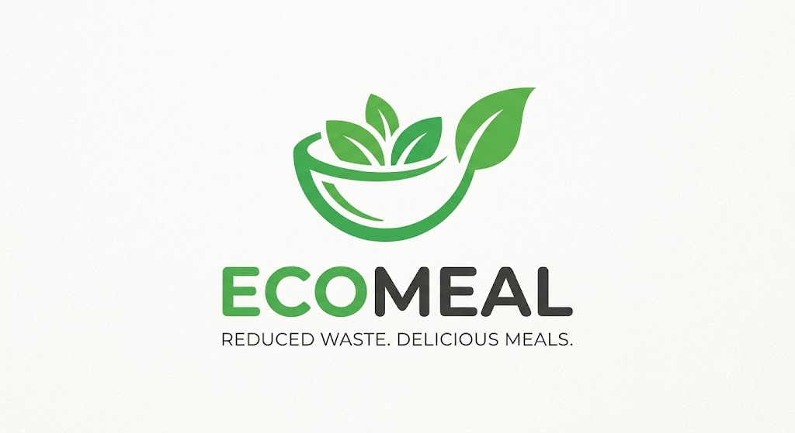

<div align="center">



# EcoMeal

**Good food shouldn't end up in the bin.**

A full-stack web platform where restaurants, bakeries and shops sell their surplus food as discounted packages, and customers nearby pick them up before closing time.


</div>

---

## About

Every evening, restaurants and shops throw away food that is still perfectly good. EcoMeal connects them with people nearby who are happy to buy it for less.

- **Partners** (restaurants, bakeries, shops) publish surplus food packages with a price, a quantity and a pickup window.
- **Customers** browse packages in their city, sorted by distance, reserve them, and pick them up in store.
- **Admins** manage users and follow platform-wide statistics.

## Features

### For customers
- 🔎 **Search and browse** businesses and packages by city, with the real driving distance and time to each place
- ⏰ **Ending Soon**: packages whose pickup window closes within the next hour, many of them already discounted
- 🛒 **Basket and orders**: reserve packages, get a confirmation, and show the order at pickup
- ❤️ **Favorites**: save the places you like
- ⭐ **Reviews**: rate a business after picking up an order from it
- 🎁 **Loyalty program**: complete 3 orders and claim a 20% discount for any future basket
- 🌍 **Bilingual UI**: switch between English and Romanian at any time

### For partners
- 🏪 Create and manage your business page
- 📦 Publish packages with quantity, price and pickup window
- 📉 **Scheduled discounts**: set a discount that applies automatically in the last X hours before pickup ends
- 📋 See incoming orders and rate customers after each pickup
- 📊 Sales and activity statistics for your business

### For admins
- 👥 User management
- 📈 Platform-wide statistics

## Under the hood

| Area | What happens |
| --- | --- |
| **Authentication** | ASP.NET Core Identity with JWT bearer tokens and three roles: `User`, `Partner`, `Admin` |
| **Email confirmation** | Required when an SMTP server is configured; in development, emails are logged instead of sent |
| **Automatic discounts** | A background service watches pickup windows and applies partners' scheduled discounts on time |
| **Geocoding** | Business addresses are turned into coordinates; a backfill job geocodes older listings too |
| **Distance** | Real driving distance and time from the [OSRM](https://project-osrm.org/) routing API, with a straight-line (Haversine) fallback if the API is unavailable |
| **Database** | SQL Server through Entity Framework Core, with migrations applied and seed data created on startup |
| **API docs** | OpenAPI document and Swagger UI in development |
| **Deployment** | Separate Docker images for the API and the Blazor client |

## Architecture

```
┌──────────────────────┐      HTTPS + JWT      ┌──────────────────────┐      EF Core      ┌──────────────┐
│    Blazor client     │  ───────────────────▶ │   ASP.NET Core API   │ ────────────────▶ │  SQL Server  │
│  (EcoMeal.client)    │ ◀───────────────────  │    (EcoMeal.api)     │ ◀──────────────── │              │
└──────────────────────┘        JSON           └──────────────────────┘                   └──────────────┘
          │                                              │
          ▼                                              ▼
   OSRM routing API                         Geocoding service · SMTP (optional)
```

```
EcoMeal/
├── EcoMeal.api/            # ASP.NET Core Web API (controllers, EF Core, Identity, background services)
├── Ecomeal.client/         # Blazor Web App (pages, components, services, localization)
├── Dockerfile.api          # Docker image for the API
└── Dockerfile.client       # Docker image for the client
```

## Tech stack

- **Backend:** C#, ASP.NET Core (.NET 10), Entity Framework Core, ASP.NET Core Identity, JWT
- **Frontend:** Blazor (Server + WebAssembly), custom CSS
- **Database:** Microsoft SQL Server
- **Tooling:** Docker, Swagger / OpenAPI, Git

## Getting started

### Prerequisites
- [.NET 10 SDK](https://dotnet.microsoft.com/download)
- SQL Server (Express or Developer edition is enough)
- *(optional)* Docker

### 1. Clone the repository
```bash
git clone https://github.com/RaduPelea/EcoMeal.git
cd EcoMeal
```

### 2. Configure the database
Set your connection string in `EcoMeal.api/EcoMeal.api/appsettings.json`:
```json
"ConnectionStrings": {
  "DefaultConnection": "Server=.\\SQLEXPRESS;Database=EcoMeal;Trusted_Connection=True;TrustServerCertificate=True"
}
```
The database is created and migrated automatically the first time the API starts.

### 3. Run the API
```bash
cd EcoMeal.api/EcoMeal.api
dotnet run
```
In development, Swagger UI is available at `/swagger`.

### 4. Run the client
In a second terminal:
```bash
cd Ecomeal.client/Ecomeal.client/Ecomeal.client
dotnet run
```
Make sure `ApiBaseUrl` in the client's `appsettings.json` points to the API.

### Run with Docker
```bash
docker build -f Dockerfile.api -t ecomeal-api .
docker build -f Dockerfile.client -t ecomeal-client .

docker run -p 8080:8080 -e ConnectionStrings__DefaultConnection="<your-connection-string>" ecomeal-api
docker run -p 8081:8080 -e ApiBaseUrl="http://localhost:8080/" ecomeal-client
```

## Configuration

| Setting | Where | Description |
| --- | --- | --- |
| `ConnectionStrings:DefaultConnection` | API | SQL Server connection string |
| `Email:Host`, `Port`, `Username`, `Password`, `From` | API | SMTP settings; leave `Host` empty to log emails instead of sending them |
| `AllowedOrigins` | API | Comma-separated list of client URLs allowed by CORS |
| `ApiBaseUrl` | Client | Base URL of the API |

Keep real secrets out of Git: use `dotnet user-secrets` locally and environment variables in production.

## Roadmap

- [ ] Online payments at checkout
- [ ] Push / email notifications for favorite places
- [ ] Map view of nearby packages
- [ ] Automated tests and CI with GitHub Actions

## Author

**Radu-Stefan Pelea**: [GitHub](https://github.com/RaduPelea)
